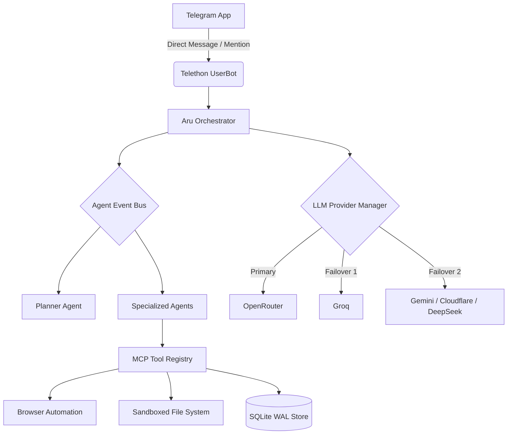

# Aru — Personal Telegram AI UserBot

Aru is a Python-based Telegram UserBot designed to act as your personal AI assistant. It integrates directly into your existing Telegram account, providing a unified interface for task management, persistent memory, scheduling, and autonomous background workflows.

At its core, Aru leverages a multi-agent architecture where a central Planner Agent decomposes complex goals and delegates them to specialized sub-agents. It utilizes the Model Context Protocol (MCP) to safely execute tools, manage system resources, and interact with the web through headless browser automation.

Built with resilience in mind, the system features an automatic failover mechanism across multiple AI providers, ensuring continuous availability even during rate limits or service outages. All data, including conversation history, task logs, and semantic memories, is stored locally in an optimized SQLite database.

## Features

* **Multi-Agent Automation:** A centralized `AgentManager` coordinates a `PlannerAgent` and five specialized agents via an async Event Bus to execute Directed Acyclic Graph (DAG) workflows.
* **Multi-Provider LLM Failover:** Automatic fallback routing across OpenRouter, Groq, Gemini, Cloudflare, and DeepSeek, complete with exponential backoff and circuit breakers.
* **Semantic Memory System:** Hybrid search combining FTS5 BM25 and Vector Reciprocal Rank Fusion (RRF) for context retrieval and memory consolidation.
* **Model Context Protocol (MCP):** A unified tool registry supporting typed JSON schemas and granular permission execution for file reading, browser automation, and web research.
* **Grounded Web Research:** Integrated web search capabilities (DuckDuckGo, Tavily, Serper) with deduplication, citation verification, and persistent caching.
* **Knowledge Base Ingestion:** Multi-format document parsing (PDF, DOCX, Markdown, TXT) with semantic chunking.
* **Vision & Voice Capable:** OCR extraction, UI component detection, Groq Vision integration, Whisper Speech-to-Text, and wave audio synthesis.
* **Scheduling Intelligence:** Automated morning briefings, night summaries, habit tracking, and database maintenance via APScheduler.

## Architecture



The architecture relies on a central orchestrator that intercepts messages from the specified owner. Complex requests are routed through the Agent Event Bus to the Planner Agent, which breaks them down into subtasks. These subtasks are executed by specialized agents utilizing MCP-compliant tools, while all AI inference is handled by a resilient, multi-provider manager.

## Tech Stack

* **Language:** Python 3.11+
* **Telegram Client:** Telethon
* **LLM Orchestration:** Custom multi-provider circuit breaker (OpenRouter, Groq, Gemini, Cloudflare, DeepSeek)
* **Browser Automation:** Playwright (Headless Chromium)
* **Database:** SQLite (WAL mode, FTS5)
* **Scheduling:** APScheduler
* **HTTP Client:** HTTPX
* **Testing:** Pytest

## Project Structure

```text
aru-ai/
├── modules/              # Core business logic
│   ├── llm/              # Multi-Provider failover system
│   ├── multi_agent/      # AgentManager, EventBus, Planner, specialized agents
│   ├── semantic_memory/  # Vector embeddings and FTS5 hybrid search
│   ├── tools/            # MCP tool registry and implementations
│   ├── channels/         # Multi-channel routing adapters
│   └── scheduling/       # Habit and task tracking
├── tests/                # Comprehensive test suite (unit & integration)
├── scripts/              # Health checks and operational scripts
├── deployment/           # Production container configurations
├── database/             # SQLite persistent storage
├── logs/                 # Application log output
└── main.py               # Application entry point

```

## Installation

### 1. Prerequisites

* Python 3.11 or newer
* A Telegram account
* Telegram API credentials from [my.telegram.org](https://my.telegram.org/apps)
* API Keys for your preferred LLM providers (e.g., Groq, OpenRouter)

### 2. Clone the Repository

```bash
git clone https://github.com/mdmunjurul360/aru-ai.git
cd aru-ai

```

### 3. Setup Virtual Environment

**Linux / macOS:**

```bash
python3 -m venv .venv
source .venv/bin/activate
pip install -r requirements.txt
playwright install chromium

```

**Windows (PowerShell):**

```powershell
python -m venv .venv
.\.venv\Scripts\Activate.ps1
pip install -r requirements.txt
playwright install chromium

```

## Configuration

Copy the example environment file and configure your instance:

```bash
cp .env.example .env

```

### Essential Environment Variables

| Variable | Description | Required |
| --- | --- | --- |
| `TELEGRAM_API_ID` | Telegram API ID from my.telegram.org | Yes |
| `TELEGRAM_API_HASH` | Telegram API Hash | Yes |
| `BOSS_TELEGRAM_ID` | Your numeric Telegram user ID (Authorization) | Yes |
| `OPENROUTER_API_KEY` | OpenRouter API Key (Default Primary) | Optional* |
| `GROQ_API_KEY` | Groq API Key (High-speed LPU) | Optional* |
| `GEMINI_API_KEY` | Google Gemini API Key | Optional* |
| `LLM_PRIORITY` | Provider priority (e.g., `openrouter,groq,gemini`) | No |

**Note: At least one AI Provider API key must be configured.*

## AI Providers

Aru implements a self-healing LLM provider manager. If the active provider experiences a rate limit (HTTP 429), network timeout, or service degradation, the system automatically routes the request to the next provider in the configured priority chain.

Failed providers are placed on a configurable circuit breaker cooldown (default 300s) to prevent latency bottlenecks, automatically probing them with half-open requests to restore their "Healthy" status once the window expires.

## Commands

Commands can be issued in private messages to yourself (Saved Messages) or in groups by mentioning your bot's username.

| Command | Description |
| --- | --- |
| `/plan <goal>` | Triggers Planner Agent to decompose a goal into subtasks |
| `/workflow <name>` | Manually execute an autonomous workflow |
| `/agent <prompt>` | Prompts the ReAct agent for autonomous execution |
| `/task add <title>` | Add a smart task to the task manager |
| `/task list` | List all pending tasks ordered by priority |
| `/research <topic>` | Generate a grounded web research report |
| `/status` | View system health, provider status, and resource metrics |

### Advanced Commands

| Command | Description |
| --- | --- |
| `/tools list` | List all registered MCP tools and schemas |
| `/tool <name> <args>` | Manually execute a registered tool via JSON |
| `/searchmemory <q>` | Search local context via hybrid FTS5/Vector search |
| `/memories [cat]` | List stored memories by category |
| `/clearchat` | Clear persistent chat history for the current session |

## Screenshots

*(Add relevant screenshots of the bot in action, system status outputs, or multi-agent planning responses here)*

## Testing

The project includes an automated test suite featuring over 160 isolated unit and integration tests using temporary SQLite databases.

Run the test suite using pytest:

```bash
python -m pytest -v

```

## Security

* **No Secrets Committed:** All sensitive credentials are managed via the `.env` file.
* **Strict Authorization:** The bot explicitly drops all commands and messages from users whose Telegram ID does not match the configured `BOSS_TELEGRAM_ID`.
* **Sandboxed Execution:** File reader and browser tools operate within defined directory scopes to prevent path traversal.
* **Responsible Use:** UserBots operate on your personal account. Please adhere strictly to the [Telegram Terms of Service](https://telegram.org/tos) regarding automated account activity.

## Roadmap

* **Vector Database Expansion:** Migrate from pure SQLite memory to dedicated local vector stores (e.g., ChromaDB/Milvus) for massive context ingestion.
* **Expanded Channel Adapters:** Finalize two-way syncing for WhatsApp and Discord endpoints.
* **Web Dashboard:** Implement a local lightweight web UI for visualizing the Agent Event Bus and DAG execution graphs.

## Contributing

1. Fork the repository
2. Create a feature branch (`git checkout -b feature/amazing-feature`)
3. Commit your changes (`git commit -m 'Add some amazing feature'`)
4. Ensure all tests pass (`pytest`)
5. Push to the branch (`git push origin feature/amazing-feature`)
6. Open a Pull Request

## Disclaimer

AI tools were utilized during the brainstorming and early prototyping phases of this project. The architecture design, multi-agent integration, database implementation, debugging, testing, and ongoing maintenance were completed manually by the author.

This software is for personal educational use. You are solely responsible for how you use this bot on your Telegram account.

## License

This project is intended for private personal use. You are free to fork and customize the codebase for your personal requirements.
